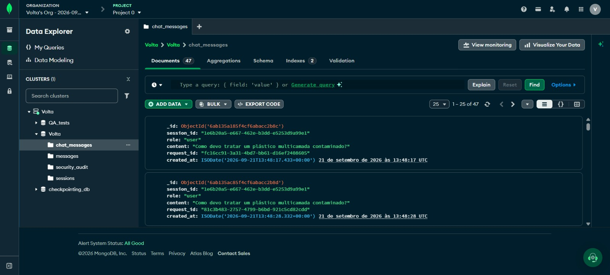
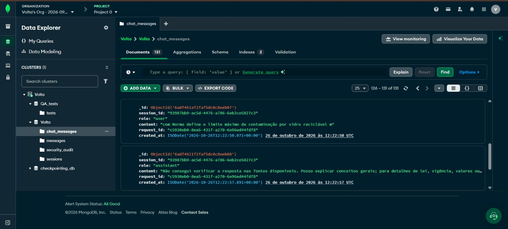
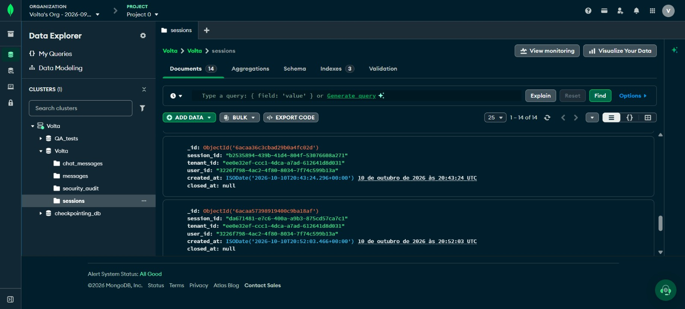
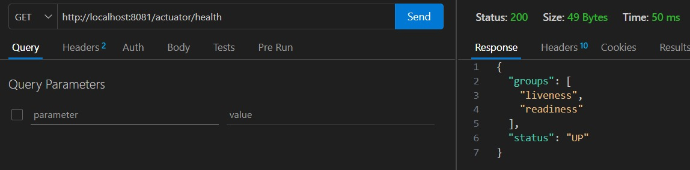
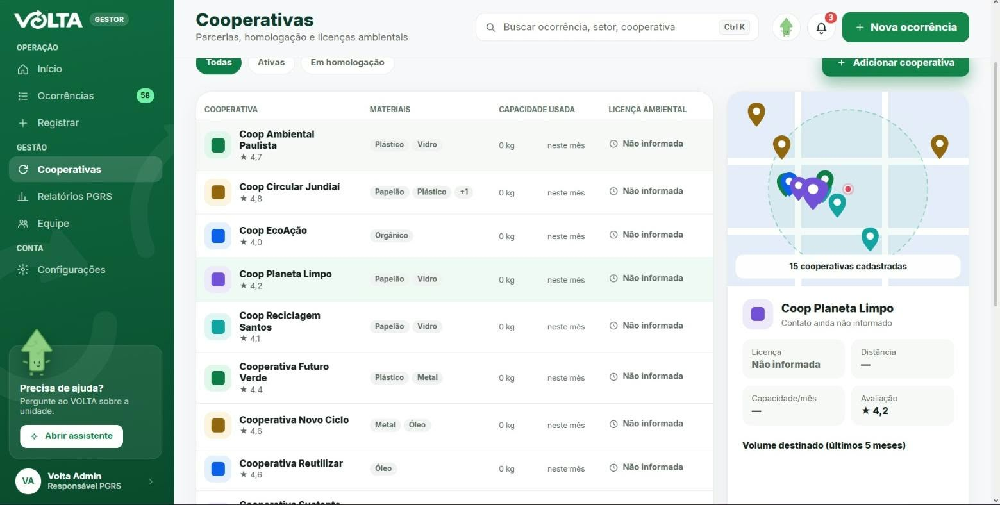
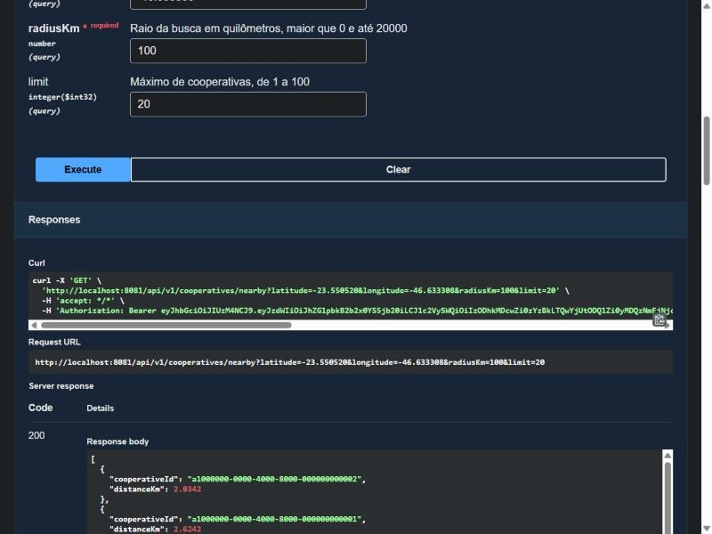
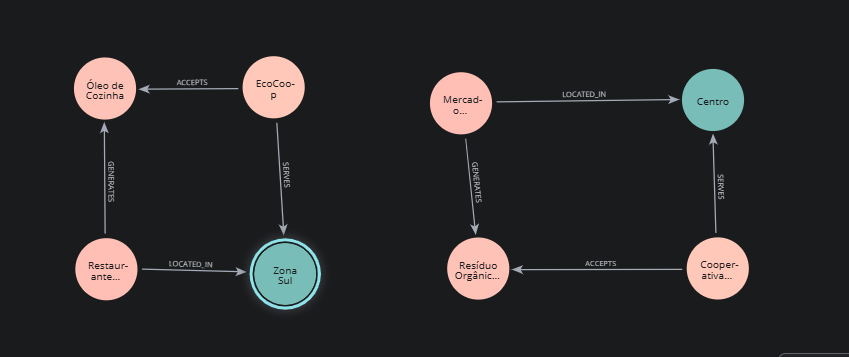
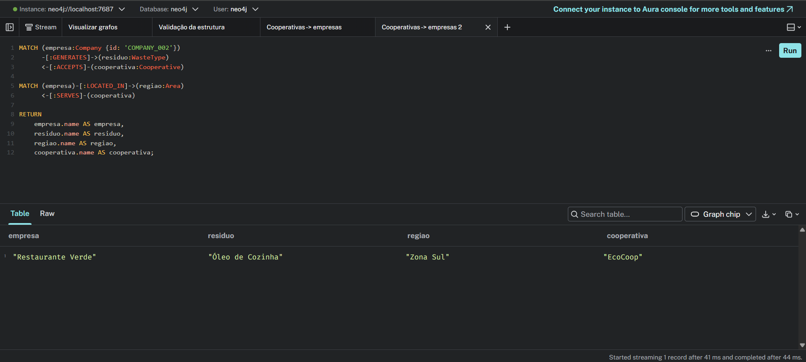
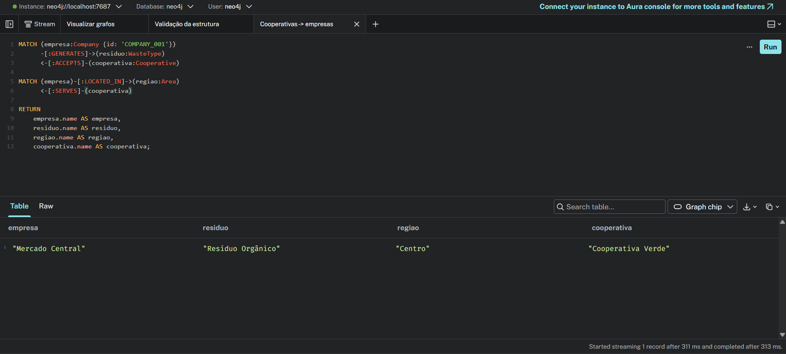

# VOLTA — Documentação dos Bancos de Dados

## 1. Objetivo

Este documento apresenta os bancos de dados utilizados no projeto VOLTA, suas finalidades, estruturas relevantes e evidências de funcionamento. O objetivo é registrar como cada tecnologia é utilizada e quais validações foram realizadas durante o desenvolvimento.

## 2. Visão geral

O projeto utiliza diferentes tecnologias de armazenamento conforme as necessidades de seus componentes.

| Tecnologia | Finalidade documentada                                                     |
| ---------- | -------------------------------------------------------------------------- |
| PostgreSQL | Armazenamento de dados relacionais.                                        |
| MongoDB    | Persistência de mensagens e sessões relacionadas ao chatbot.             |
| Redis      | Armazenamento utilizado pela API relacionada ao ranking.                   |
| Neo4j      | Protótipo local de modelagem de entidades e consultas de relacionamentos. |

As tecnologias possuem finalidades distintas. A utilização de mais de um banco de dados não significa que todos estejam diretamente integrados entre si.

## 3. MongoDB

### 3.1. Finalidade

O MongoDB é utilizado para persistir informações relacionadas às conversas do chatbot. Entre os dados observados estão as mensagens trocadas e os registros de sessões.

### 3.2. Estrutura dos dados

Nas collections verificadas, foram identificados os seguintes campos:

**Collection `chat_messages`:**

- `_id`: identificador do documento.
- `session_id`: identificador da sessão associada à mensagem.
- `role`: papel associado à mensagem, como `user`.
- `content`: conteúdo textual da mensagem.
- `request_id`: identificador da requisição.
- `created_at`: data e horário de criação do registro.

**Collection `sessions`:**

- `_id`: identificador do documento.
- `session_id`: identificador da sessão.
- `tenant_id`: identificador do contexto ou organização associado à sessão.
- `user_id`: identificador do usuário.
- `created_at`: data e horário de criação.
- `closed_at`: informação de encerramento da sessão, que pode estar nula enquanto a sessão permanece aberta.

Os campos acima correspondem aos documentos observados nas evidências. Outros campos podem existir na implementação.

### 3.3. Evidências de funcionamento

A persistência foi verificada por meio da visualização dos documentos armazenados no MongoDB Atlas.

**Figura 1 — Mensagens persistidas na collection `chat_messages`.**

**Figura 2 — Registros armazenados na collection `sessions`.**

### 3.4. Validação

As evidências mostram documentos armazenados nas collections de mensagens e sessões. A validação funcional do chatbot também foi realizada por meio do envio de mensagens e da verificação de sua persistência no banco de dados.

## 4. Redis

### 4.1. Finalidade

O Redis é utilizado pelo componente da API responsável pelas funcionalidades relacionadas ao ranking do projeto.

### 4.2. Conexão

A conexão e a disponibilidade do componente foram verificadas durante os testes da aplicação.

**Figura 3 — Verificação do endpoint de saúde da aplicação.**

O endpoint `/actuator/health` retornou o status HTTP `200` e apresentou o estado geral `UP`. Essa resposta demonstra que o endpoint de saúde respondeu corretamente, mas, isoladamente, não comprova a conexão com o Redis.

### 4.3. Funcionamento do ranking

Esta seção será complementada com a evidência da API executando a funcionalidade de ranking utilizando dados fictícios de teste.

**Figura 4 — Resultado do ranking retornado pela API.**

### 4.4. Validação

A validação do ranking deverá considerar a execução da funcionalidade e a conferência dos resultados retornados pela API, conforme os dados utilizados no teste.

## 5. Neo4j

### 5.1. Finalidade

O Neo4j foi utilizado em um protótipo local para representar entidades do domínio do VOLTA e consultar relacionamentos entre elas.

### 5.2. Modelo de dados

O protótipo contempla os seguintes tipos de nós:

- `Company`: empresas.
- `Cooperative`: cooperativas.
- `WasteType`: tipos de resíduos.
- `Area`: áreas de atendimento.

Os relacionamentos modelados incluem:

- `Company` — `GENERATES` → `WasteType`
- `Company` — `LOCATED_IN` → `Area`
- `Cooperative` — `ACCEPTS` → `WasteType`
- `Cooperative` — `SERVES` → `Area`

### 5.3. Consultas e validação

Foram realizadas consultas no ambiente local para verificar os relacionamentos e testar cenários de compatibilidade entre empresas, tipos de resíduos, cooperativas e áreas de atendimento.

**Figura 5 — Evidência das consultas realizadas no protótipo Neo4j.**

O protótipo utiliza dados de demonstração e não deve ser interpretado como uma integração sincronizada com o banco relacional PostgreSQL.

## 6. Considerações finais

Os bancos de dados são utilizados conforme as necessidades específicas dos componentes do VOLTA. As evidências apresentadas registram as estruturas observadas e as validações realizadas, diferenciando a persistência de dados, a disponibilidade dos serviços e o funcionamento das funcionalidades da aplicação.
