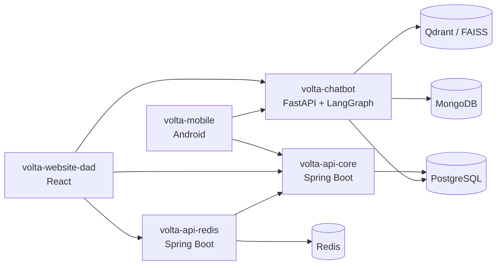

# VOLTA — Padrões de Projeto, Arquitetura e Princípios de Design

## 1. Objetivo

Este documento resume os padrões de projeto, a arquitetura e os princípios de design (SOLID) encontrados no código da plataforma VOLTA. Para cada item, mostra onde ele aparece e para que serve.

## 2. Visão geral



| Repositório | Função |
|---|---|
| `volta-api-core` | API principal: ocorrências, coletas, cooperativas, métricas ESG, usuários e login |
| `volta-api-redis` | API de apoio: ranking de empresas e indicação das melhores cooperativas por ocorrência |
| `volta-chatbot` | Chatbot com IA e análise de fotos de resíduos |
| `volta-mobile` | Aplicativo Android para registrar e acompanhar ocorrências |
| `volta-website-dad` | Painel web para gestão, relatórios e aprovação de ocorrências |

Ideias que valem para todo o sistema:

- **Cada serviço tem uma função clara** (negócio, ranking, IA), com repositório e pipeline próprios.
- **O banco PostgreSQL da API principal é a fonte oficial dos dados.** O Redis guarda apenas cópias organizadas para consulta rápida.
- **O login é único:** o token emitido pela API principal vale para os demais serviços.
- **Cada empresa só acessa os próprios dados.**

## 3. `volta-api-core` — API principal

### 3.1. Arquitetura em camadas

O código é dividido em camadas, e cada uma tem um papel:

```text
Controller  →  UseCase (contrato)  →  Service (regras de negócio)  →  Repository (banco)
```

- O **controller** recebe a requisição e chama o caso de uso.
- O **service** aplica as regras de negócio.
- O **repository** acessa o banco.

Assim, mudar uma camada raramente exige mexer nas outras, e cada parte pode ser testada separadamente.

### 3.2. Princípios SOLID

| Princípio | Como aparece |
|---|---|
| **S** — Responsabilidade única | Há classes com papel único: o mapper só converte dados, o tratador de erros só trata erros, o provedor de token só gera e valida tokens. Exceção: `IncidentService` concentra muitas regras e dependências. |
| **O** — Aberto/fechado | Um recurso novo entra com novas classes, sem alterar as existentes. |
| **L** — Substituição de Liskov | Todo service cumpre o contrato do seu caso de uso, e as exceções de domínio são tratadas do mesmo jeito. |
| **I** — Segregação de interfaces | Há um contrato por assunto (`AreaUseCase`, `GoalUseCase`, `AuthUseCase`…) em vez de um contrato único e enorme. |
| **D** — Inversão de dependência | O controller depende da interface (`CollectionUseCase`), e o Spring entrega a implementação (`CollectionService`). |

### 3.3. Padrões de projeto

| Padrão | Onde aparece | Para que serve |
|---|---|---|
| **Injeção de dependências** | Todas as classes recebem o que precisam pelo construtor | Deixar as dependências claras e facilitar testes |
| **Repository** | `database/repository` | Isolar o acesso ao banco |
| **DTO** | `dto/` (objetos de entrada e saída da API) | Não expor as entidades do banco |
| **Mapper** | `mapper/` | Concentrar a conversão entre entidade e DTO |
| **Tratamento central de erros** | `GlobalExceptionHandler` | Respostas de erro padronizadas |
| **Hierarquia de exceções** | `VoltaException` e suas filhas | Cada erro de negócio já traz o código HTTP correto |
| **Chain of Responsibility** | `JwtAuthenticationFilter` na cadeia de filtros de segurança | Validar o token antes de a requisição chegar ao controller |
| **Controle de acesso por perfil** | `@PreAuthorize` com perfis como `ADMIN` | Restringir cada operação ao perfil permitido |
| **Isolamento por empresa** | Consultas filtradas pelo `companyId` do usuário | Uma empresa não vê dados de outra |
| **Configuração tipada** | Classes `*Properties` | Evitar valores fixos espalhados |
| **Migrações de banco** | `db/migration` (Flyway) | Evoluir o banco de forma controlada |
| **Regras no banco** | Procedures, funções e triggers | Garantir integridade perto dos dados |
| **Documentação separada** | `controller/docs` (Swagger) | Manter o controller limpo |

### 3.4. Segurança e entrega

- Autenticação por token (JWT), sem sessão no servidor, e senhas criptografadas com BCrypt.
- Erros de acesso (401 e 403) seguem o mesmo formato das demais respostas.
- O Swagger fica protegido por usuário e senha.
- Dockerfile em duas etapas (build e execução), rodando com usuário sem privilégios.
- CI e CD no GitHub Actions.

## 4. `volta-api-redis` — Ranking e cooperativas próximas

### 4.1. Arquitetura

Usa o mesmo estilo em camadas da API principal. A diferença é que os dados ficam no Redis, em vez de um banco relacional.

### 4.2. Padrões de projeto

| Padrão | Onde aparece | Para que serve |
|---|---|---|
| **Adapter** | `VoltaApiClient` (contrato) e `RestVoltaApiClient` (implementação) | Isolar a comunicação com a API principal |
| **Repository** | `RankingRepository`, `ScoreHistoryRepository`, `CooperativeGeoRepository` | Esconder os detalhes do Redis |
| **Cálculo separado** | `CooperativeScoreCalculator` | A regra de pontuação pode ser testada sem Redis nem HTTP |
| **Pesos configuráveis** | `ScoringProperties` | Ajustar a pontuação sem mexer no código |
| **Limite de tempo nas chamadas externas** | `VoltaApiClientConfiguration` | Evitar travar quando a outra API demora |
| **Validação na entrada** | Limites de nota, página, coordenadas e raio | Barrar dados inválidos antes do Redis |

### 4.3. SOLID

- **S:** serviço de ranking, serviço de cooperativas e calculador de pontuação são separados.
- **D:** a pontuação depende do contrato `VoltaApiClient`, e não da implementação.
- **I:** cada caso de uso é pequeno e específico.
- **O:** os pesos mudam por configuração, mas um novo critério de pontuação exige alterar o calculador.

## 5. `volta-chatbot` — Chatbot com IA

### 5.1. Arquitetura

```text
app/
  api/    rotas HTTP
  core/   login, regras de segurança da IA (guardrails), monitoramento
  ai/     fluxo dos agentes, busca em documentos (RAG), prompts
  db/     modelos e acesso aos bancos
```

Cada mensagem passa por um fluxo fixo:

```text
entrada → proteção de entrada → roteador → especialista → juiz → orquestrador → proteção de saída
```

1. A proteção de entrada remove dados pessoais e bloqueia tentativas de manipular a IA.
2. O roteador escolhe um especialista: triagem, normas, dados ou performance.
3. O juiz confere se a resposta é coerente e tem base em fontes.
4. O orquestrador monta a resposta final.
5. A proteção de saída faz a última limpeza.

### 5.2. Padrões de projeto

| Padrão | Onde aparece | Para que serve |
|---|---|---|
| **Fluxo em etapas (pipeline)** | `ai/graph.py` | Caminho explícito e fácil de auditar |
| **Roteador** | Agente roteador | Enviar cada pergunta ao especialista certo |
| **Agentes especializados** | `AgentTeam` | Cada agente tem prompt, ferramentas e modelo próprios |
| **Juiz de IA** | Etapa `judge` | Reduzir respostas sem base |
| **Guardrails** | `core/guardrails.py` | Proteger dados pessoais e o escopo, sem depender da IA |
| **Contratos estruturados** | Modelos Pydantic em `db/models.py` | Agentes se comunicam com dados tipados, não texto livre |
| **Facade (RAG federado)** | `FederatedRag` | Uma única entrada para várias bases de documentos |
| **Repository** | `PostgresRepository` e `SessionRepository` | Isolar o acesso aos bancos |
| **Injeção de dependências** | `Depends` do FastAPI | Facilitar testes |
| **Validação humana** | Ocorrências criadas pela IA ficam como rascunho até aprovação | A decisão final é de uma pessoa |
| **Monitoramento** | `core/observability.py` e LangSmith | Acompanhar uso, custo e falhas |

### 5.3. SOLID

- **S:** os módulos são bem separados, mas a classe `AgentTeam` (cerca de 560 linhas) faz coisas demais.
- **D:** as rotas recebem as dependências por injeção, mas elas são instâncias globais, sem contrato.
- **O:** incluir um novo especialista exige alterar o `AgentTeam` e o fluxo.
- **Testes:** cerca de 25 arquivos de teste cobrem segurança, autenticação, RAG, sessões e relatórios.

## 6. `volta-mobile` — Aplicativo Android (Java)

### 6.1. Arquitetura

Aplicativo de uma única tela principal (`MainActivity`), com navegação entre `Fragment`s. O código se divide em:

- `ui/`: telas.
- `data/api`: comunicação com as APIs.
- `data/model`: modelos de dados.
- `data/local`: dados salvos no aparelho.
- `data/sync`: fila de envio quando o aparelho volta a ter internet.
- `data/notification`, `data/upload`: notificações (Firebase) e envio de fotos (Cloudinary).

### 6.2. Padrões de projeto

| Padrão | Onde aparece | Para que serve |
|---|---|---|
| **Uma interface por recurso (Retrofit)** | `OccurrenceAPI`, `AuthAPI`, `CooperativeAPI`… | Contratos de rede pequenos |
| **Singleton** | `ApiClient` e `FirestoreNotificationRepository` | Reaproveitar o cliente HTTP e a conexão |
| **Interceptor** | `ApiClient` | Incluir o token em toda chamada |
| **Repository** | `FirestoreNotificationRepository`, `OccurrenceStore` | Isolar as fontes de dados |
| **Funcionamento offline** | `SyncQueue` e `SyncManager` | Registrar ocorrências sem internet e enviar depois |
| **Adapter** | `OccurrenceAdapter`, `CooperativeAdapter`… | Mostrar listas na tela |
| **Classes utilitárias** | `OccurrenceFilter`, `AuthValidator` | Lógica simples, fácil de testar |
| **Testes de contrato** | `*ContractTest` | Detectar quebras entre app e APIs |

### 6.3. SOLID

- **S:** API, modelo, dados locais e telas são separados, mas Fragments grandes (como `OccurrenceDetailFragment`, com cerca de 970 linhas) acumulam funções.
- **I:** as interfaces de rede são pequenas e por assunto.
- **D:** ponto mais fraco. As telas chamam diretamente classes estáticas (`ApiClient`, `SessionManager`, `SyncManager`), o que dificulta testes.
- **O:** telas e APIs novas entram como arquivos novos, mas sincronização e notificações dependem de classes centrais.

## 7. `volta-website-dad` — Painel web

### 7.1. Arquitetura

```text
src/
  pages/        telas
  components/   componentes reutilizáveis
  hooks/        lógica reutilizável (busca de dados, debounce…)
  services/     comunicação com as APIs e mocks
  context/      sessão do usuário
  types/        tipos TypeScript
  utils/        funções auxiliares
```

Regra do projeto: as telas **nunca** chamam a API diretamente. Tudo passa pela camada `services`.

### 7.2. Padrões de projeto

| Padrão | Onde aparece | Para que serve |
|---|---|---|
| **Camada de serviços** | `services/http.ts` | Erros, token e tempo limite tratados em um só lugar |
| **Troca entre API e mock** | `ocorrencias.api.ts` e `ocorrencias.mock.ts` seguem o mesmo contrato | Rodar o painel sem backend |
| **Adapter** | `services/adaptadores.ts` | Converter o formato da API para o usado nas telas |
| **Hooks personalizados** | `useOcorrencias`, `useCooperativas`… | Reutilizar a lógica de carregamento |
| **Cancelamento de requisições** | `AbortController` nos hooks | Evitar atualizar telas já fechadas |
| **Observer** | `assinarMudancas` | Atualizar as telas quando as ocorrências mudam |
| **Cache com validade** | `services/cache.ts` | Evitar repetir consultas |
| **Context** | `AuthContext` | Compartilhar a sessão entre as telas |
| **Proteção de rotas** | `PrivateRoute` | Bloquear telas para quem não fez login |
| **Carregamento sob demanda** | `lazy` e `Suspense` em `App.tsx` | Carregar cada página só quando necessário |
| **Reducer** | `pages/Registrar/reducer.ts` | Controlar as etapas do cadastro de ocorrência |

### 7.3. SOLID

- **S:** hooks, serviços, tipos e componentes têm papéis claros. Dois arquivos são grandes (`adaptadores.ts` e `ocorrencias.api.ts`).
- **O e L:** incluir ou trocar uma fonte de dados (mock ou API) não altera as telas.
- **I:** os serviços são divididos por assunto.
- **D:** telas e hooks dependem do contrato do serviço. A implementação é escolhida em um único ponto, por variável de ambiente.

### 7.4. Qualidade e entrega

- Husky, commitlint e oxlint verificam commits e código.
- CI no GitHub Actions, Docker com nginx e deploy na Vercel.
- Testes unitários com Vitest (`src/testes/`) rodam no CI. Detalhes em [padroes-de-teste.md](padroes-de-teste.md).

## 8. Padrões comuns aos repositórios

| Tema | Como aparece |
|---|---|
| **Camadas** | APIs em controller/service/repository; chatbot em api/core/ai/db; mobile em ui/data; web em pages/hooks/services |
| **Contratos de dados** | Records no Java, Pydantic no Python, tipos no TypeScript |
| **Programar para contratos** | `UseCase` e `VoltaApiClient` (Java), `ServicoOcorrencias` (web), interfaces Retrofit (Android) |
| **Erros padronizados** | `ProblemDetail` nas APIs Java, `ErroHttp` na web |
| **Segurança** | Token compartilhado, perfis de acesso, isolamento por empresa, guardrails de IA |
| **Configuração externa** | `*Properties` no Java, `.env.example` em todos os projetos |
| **Entrega** | GitHub Actions e Docker; workflows compartilhados no `volta-devops` |
| **Commits** | Padrão Conventional Commits |

## 9. Conclusão

O VOLTA tem uma arquitetura coerente: serviços com funções distintas, camadas bem definidas, contratos claros entre os componentes e cuidado com segurança e entrega automatizada.

Os principais pontos fortes são a separação em camadas com casos de uso nas APIs Java, o isolamento da integração entre as APIs, a troca simples entre API e mock no painel web e o fluxo do chatbot, com proteções, juiz e validação humana.