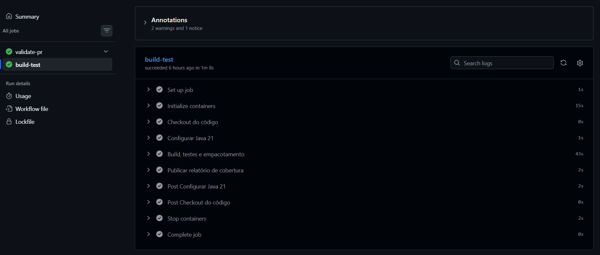
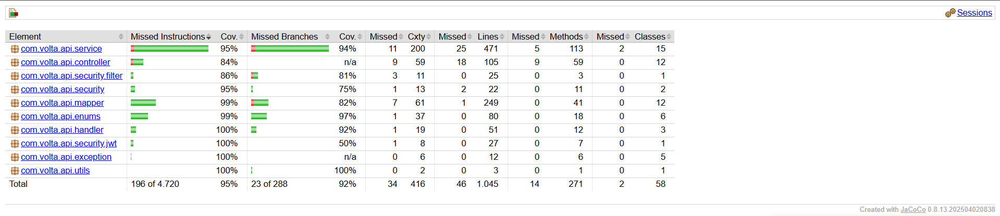
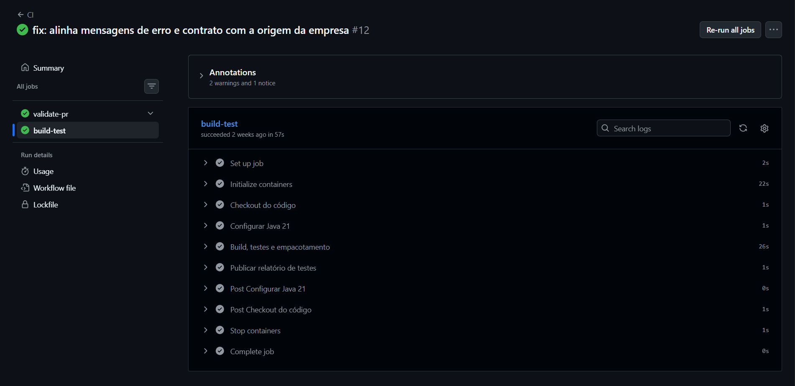
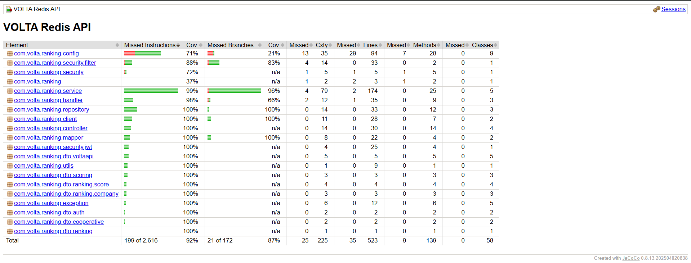
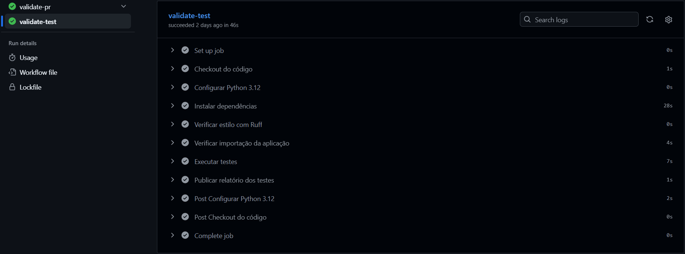
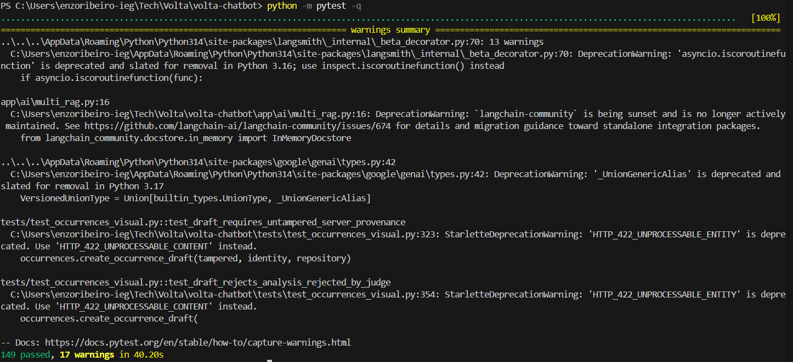
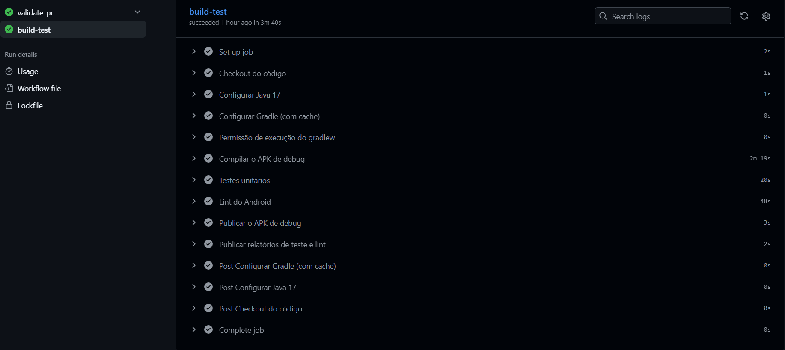
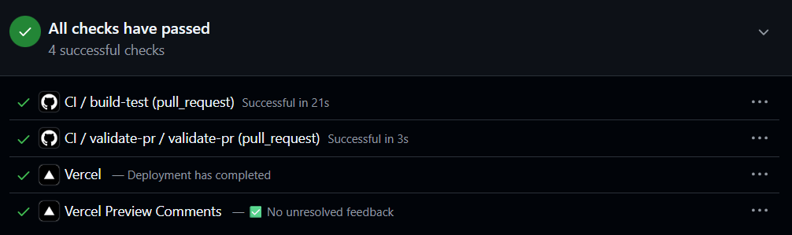
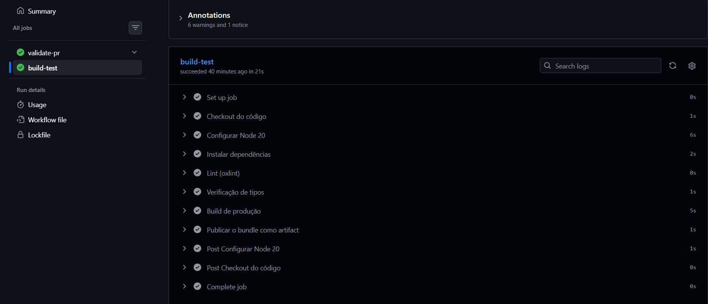

# VOLTA — Padrões de Teste

## 1. Objetivo

Este documento resume como os testes são feitos em cada repositório do VOLTA: ferramentas, tipos de teste, organização e execução no CI. Também aponta o que ainda falta cobrir.

## 2. Visão geral

| Repositório | Ferramentas | Tipos de teste | Quantidade aproximada | Cobertura mínima exigida no CI |
|---|---|---|---|---|
| `volta-api-core` | JUnit 5, Mockito, AssertJ, Spring MockMvc | Unitário, validação de DTO, segurança | 253 testes | 35% das linhas (JaCoCo) |
| `volta-api-redis` | JUnit 5, AssertJ, Spring Boot Test, Redis real | Unitário, integração HTTP, integração com Redis | 148 testes | 85% das linhas (JaCoCo) |
| `volta-chatbot` | pytest, httpx, classes fake | Unitário, API (rotas), contrato dos agentes | 132 testes | Sem mínimo definido |
| `volta-mobile` | JUnit 4 | Unitário e contrato JSON | 83 testes | Sem mínimo definido |
| `volta-website-dad` | — | Nenhum teste automatizado | 0 | Não se aplica |

Os números são contagens do código, não resultado de execução.

## 3. Princípios comuns

- **Testar regra de negócio, validação e segurança**, que são os pontos de maior risco.
- **Isolar o que está sendo testado:** dependências externas (banco, outras APIs, IA) são trocadas por mocks ou fakes.
- **Testes independentes e repetíveis:** cada teste monta seus próprios dados e não depende da ordem de execução.
- **Nomes que explicam o comportamento**, como `givesFullScoreToATopRatedCooperativeRightAtTheOrigin` ou `test_blocks_prompt_injection`.
- **Contratos entre sistemas são testados**, para detectar quebras entre app, painel e APIs.
- **Os testes rodam automaticamente** em todo pull request, pelo GitHub Actions.

## 4. `volta-api-core` — API principal

### 4.1. Organização

Os testes ficam em `src/test/java/com/volta/api/`, com a mesma estrutura dos pacotes do código:

| Pasta | O que testa |
|---|---|
| `service/` | Regras de negócio de cada service (ocorrências, coletas, usuários, ESG…) |
| `security/` | Token JWT, filtro de autenticação, código de recuperação de senha e permissões por perfil |
| `handler/` | Respostas de erro (404, 409, 403…) |
| `dto/` | Regras de validação dos dados de entrada, como CNPJ |
| `enums/` e `utils/` | Regras de classes pequenas e funções auxiliares |
| `support/` | Fábricas de dados de teste (`UserFixtures`, `CollectionFixtures`, `WasteTypeFixtures`) |

### 4.2. Padrões usados

| Padrão | Como aparece | Para que serve |
|---|---|---|
| **Teste unitário com mocks** | `@ExtendWith(MockitoExtension.class)` e `@Mock` para repositórios | Testar o service sem banco de dados |
| **Fixtures** | Classes em `support/` criam entidades e usuários prontos | Evitar repetir montagem de dados |
| **Testes agrupados e descritivos** | `@Nested` e `@DisplayName` em português | Relatório de testes fácil de ler |
| **Testes parametrizados** | `@ParameterizedTest` (21 usos) | Cobrir vários casos com um único teste |
| **Teste de segurança por perfil** | `RoleAuthorizationTest` com `@WebMvcTest` e `MockMvc` | Garantir que cada rota só aceita os perfis permitidos |
| **Verificação de chamadas** | `verify`, `never` e `ArgumentCaptor` | Conferir que o service gravou (ou não gravou) o que devia |
| **Asserções fluentes** | AssertJ (`assertThat`, `assertThatThrownBy`) | Falhas com mensagens claras |
| **Teste de carga do contexto** | `VoltaApiApplicationTests` | Garantir que a aplicação sobe com a configuração de teste |

### 4.3. Exemplo de estrutura

```java
@ExtendWith(MockitoExtension.class)
@DisplayName("IncidentService")
class IncidentServiceTest {

    @Mock private IncidentRepository incidentRepository;
    private IncidentService service;

    @BeforeEach
    void setUp() {
        service = new IncidentService(incidentRepository, /* demais dependências */);
    }

    @Nested
    @DisplayName("ao aprovar uma ocorrência")
    class Approve {
        @Test
        @DisplayName("rejeita ocorrência que não está pendente")
        void rejectsNonPending() { /* ... */ }
    }
}
```

### 4.4. Cobertura e CI

- O JaCoCo mede a cobertura em cada `mvn verify` e **reprova o build abaixo de 35%** das linhas.
- Ficam fora da medição: DTOs, entidades, configurações e a classe principal.
- O CI sobe um PostgreSQL 16 de teste, roda `mvn --batch-mode verify` e publica o relatório de cobertura como artefato.

## 5. `volta-api-redis` — Ranking e cooperativas

### 5.1. Organização

Testes em `src/test/java/com/volta/ranking/`, com três camadas:

| Camada | Exemplos | O que testa |
|---|---|---|
| **Unitário** | `CooperativeScoreCalculatorTest`, `GeoDistanceTest`, `RankingServiceTest` | Cálculo de pontuação, distância e regras do serviço |
| **Repositório** | `RankingRepositoryTest`, `CooperativeGeoRepositoryTest` | Operações de acesso ao Redis |
| **Integração** | `*HttpIntegrationTest`, `CooperativeGeoRedisIntegrationTest` | Aplicação completa e Redis de verdade |

### 5.2. Padrões usados

| Padrão | Como aparece | Para que serve |
|---|---|---|
| **Integração HTTP real** | `@SpringBootTest` com porta aleatória e `HttpTestClient` | Testar login, permissões, validação e erros como o cliente enxerga |
| **API externa falsa** | `FakeVoltaApi`, um servidor HTTP local que simula a `volta-api-core` | Testar a integração sem depender da API real |
| **Redis descartável** | `CooperativeGeoRedisIntegrationTest` usa chave única por execução e apaga os dados no fim | Testar comandos reais do Redis sem sujar o ambiente |
| **Tokens de teste** | `TestTokens` gera JWTs de cada perfil | Testar permissões por perfil e por empresa |
| **Limpeza após cada teste** | `@AfterEach` remove os dados criados | Testes independentes entre si |
| **Dados de teste isolados** | Valores como `UUID.randomUUID()` | Evitar colisão entre execuções |
| **Testes de validação** | `*DTOValidationTest` | Garantir que dados inválidos recebem erro 400 |

### 5.3. Cobertura e CI

- O JaCoCo **reprova o build abaixo de 85%** das linhas, o critério mais rigoroso do projeto.
- O CI sobe um Redis 7 e roda `mvn --batch-mode verify`.

## 6. `volta-chatbot` — Chatbot com IA

### 6.1. Organização

Os testes ficam em `tests/`, um arquivo por assunto:

| Assunto | Arquivos |
|---|---|
| Segurança da IA | `test_guardrails.py`, `test_auth.py`, `test_operational_access.py` |
| Fluxo de chat e agentes | `test_chat.py`, `test_graph_history.py`, `test_specialist_structured_output.py`, `test_approval.py` |
| Busca em documentos (RAG) | `test_multi_rag.py`, `test_rag_startup.py`, `test_ingest_weight_references.py`, `test_norms_mcp.py` |
| Dados e sessões | `test_storage.py`, `test_sessions.py`, `test_models.py` |
| Análise de imagem e relatórios | `test_occurrences_visual.py`, `test_reports.py`, `test_predictive.py` |
| Monitoramento | `test_observability.py`, `test_langsmith_tracing.py`, `test_model_usage.py`, `test_request_context.py` |
| Configuração | `test_config.py` |

### 6.2. Padrões usados

| Padrão | Como aparece | Para que serve |
|---|---|---|
| **Funções de teste simples (pytest)** | `def test_...()` com `assert` | Testes curtos e diretos |
| **Fakes escritos à mão** | `FakeRepository`, `FakeSessions`, `FakeTelemetry`, `FakeIdentityRepository` | Substituir bancos e serviços sem acessar a rede |
| **Teste de rotas sem servidor** | `FastAPI` com `httpx.AsyncClient` e `ASGITransport` | Testar as rotas direto na memória |
| **Substituição de dependências** | `app.dependency_overrides` / `monkeypatch` | Trocar autenticação, grafo e bancos nos testes |
| **Nomes descritivos em inglês** | `test_masks_cpf_before_any_llm_or_database_operation` | O nome já descreve a regra |
| **Testes das regras de segurança** | Máscara de CPF, bloqueio de *prompt injection* e frases absolutas | Garantir as proteções que não dependem da IA |
| **Testes dos contratos** | Verificam os modelos Pydantic e a saída estruturada dos agentes | Evitar quebra entre agentes |

### 6.3. Cobertura e CI

O CI instala as dependências com verificação de hash, roda o `ruff` (análise estática), confere se a aplicação importa sem erro e executa `python -m pytest`, publicando o relatório em XML. Ainda não há cobertura mínima definida, e os testes não chamam modelos de IA reais.

## 7. `volta-mobile` — Aplicativo Android

### 7.1. Organização

Os testes unitários ficam em `app/src/test/java/com/aula/volta/`, na mesma estrutura do código:

| Pasta | O que testa |
|---|---|
| `data/model/` | Regras dos modelos e contratos JSON (ocorrência, cooperativa, notificação, análise de IA) |
| `data/api/` | Contrato de integração com o chatbot |
| `data/local/`, `data/sync/` | Armazenamento local e fila de sincronização offline |
| `data/filter/`, `data/report/` | Filtros e cálculo de relatórios (PGRS) |
| `data/notification/`, `data/upload/` | Notificações e envio de fotos |
| `ui/auth/` | Validação de e-mail e senha |
| `util/` | Imagens e navegação por mapa |

### 7.2. Padrões usados

| Padrão | Como aparece | Para que serve |
|---|---|---|
| **Testes unitários em JVM (JUnit 4)** | Rodam sem emulador | Execução rápida no CI |
| **Teste de contrato JSON** | `*ContractTest` serializam e desserializam com Gson | Detectar mudanças no formato das APIs |
| **Dados de exemplo no `@Before`** | `OccurrenceFilterTest` monta a lista de ocorrências | Reaproveitar o cenário em todos os testes da classe |
| **Foco em lógica pura** | Filtros, validadores, cálculos e modelos | Evita depender do Android |

### 7.3. Limites atuais

- Telas (Fragments) e fluxos de navegação **não têm teste automatizado**.
- A pasta `androidTest` tem apenas o exemplo gerado pelo Android Studio (`ExampleInstrumentedTest`).
- Por causa das classes estáticas do app (`ApiClient`, `SessionManager`), é difícil testar telas e a rede sem refatorar.

### 7.4. CI

O CI usa Java 17, compila o APK de debug, roda `./gradlew testDebugUnitTest` e `lintDebug`, e publica o APK e os relatórios.

## 8. `volta-website-dad` — Painel web

O repositório **não tem testes automatizados** e o `package.json` não define script de teste. A qualidade é garantida por:

- **Lint** (`oxlint`) e **verificação de tipos** (TypeScript) no CI.
- **Build de produção** no CI, que falha se houver erro de compilação.
- **Hooks do Husky** e **commitlint**, que validam o código e as mensagens de commit.
- **Mocks locais** (`*.mock.ts`), que permitem testar o painel manualmente sem backend.

Sugestão para o futuro: adotar Vitest com Testing Library, começando pelas funções puras (`utils/`, `reducer.ts`, `adaptadores.ts`) e pelos hooks.

## 9. Resumo dos padrões entre os repositórios

| Tema | API Core | API Redis | Chatbot | Mobile | Web |
|---|---|---|---|---|---|
| Testes unitários | Sim | Sim | Sim | Sim | Não |
| Mocks ou fakes | Mockito | Servidor falso e Redis real | Classes fake | Nenhum | — |
| Teste de integração | Parcial (`@WebMvcTest`) | Sim (HTTP e Redis) | Parcial (rotas) | Não | — |
| Teste de segurança | Sim | Sim | Sim | Validação de senha | — |
| Teste de contrato | Não | Sim | Sim | Sim | — |
| Cobertura medida | JaCoCo (mín. 35%) | JaCoCo (mín. 85%) | Não | Não | Não |
| Roda no CI | Sim | Sim | Sim | Sim | Só lint, tipos e build |

## 10. Evidências de execução

Os prints ficam em [`docs/prints/`](prints/).

### 10.1. `volta-api-core`

Pipeline de CI (`build-test`) aprovado:



Relatório de cobertura (JaCoCo):



### 10.2. `volta-api-redis`

Pipeline de CI (`build-test`) aprovado:



Relatório de cobertura (JaCoCo):



### 10.3. `volta-chatbot`

Pipeline de CI (`validate-test`) aprovado:



Execução local do `python -m pytest -q`:



### 10.4. `volta-mobile`

Pipeline de CI (`build-test`) aprovado, incluindo os testes unitários:



### 10.5. `volta-website-dad`

Checks do pull request aprovados (lint, tipos e build):



Pipeline de CI (`build-test`) aprovado:



## 11. Como executar

```bash
# volta-api-core (Java 21; precisa de PostgreSQL local e das variáveis do .env.example)
mvn verify

# volta-api-redis (Java 21; precisa de um Redis local na porta 6379)
./mvnw verify

# volta-chatbot
pip install -r requirements.txt -r requirements-dev.txt
python -m pytest -q

# volta-mobile
./gradlew testDebugUnitTest

# volta-website-dad (sem testes; roda lint, tipos e build)
npm run lint && npx tsc --noEmit && npm run build
```

## 12. Conclusão

As duas APIs Java têm a base de testes mais madura, com cobertura medida e mínima exigida no CI. Na API Redis, o mínimo de 85% e o uso de um Redis real dão boa confiança. O chatbot tem boa cobertura das regras de segurança e do fluxo de agentes, mas sem medição de cobertura. O app Android testa só a lógica pura.