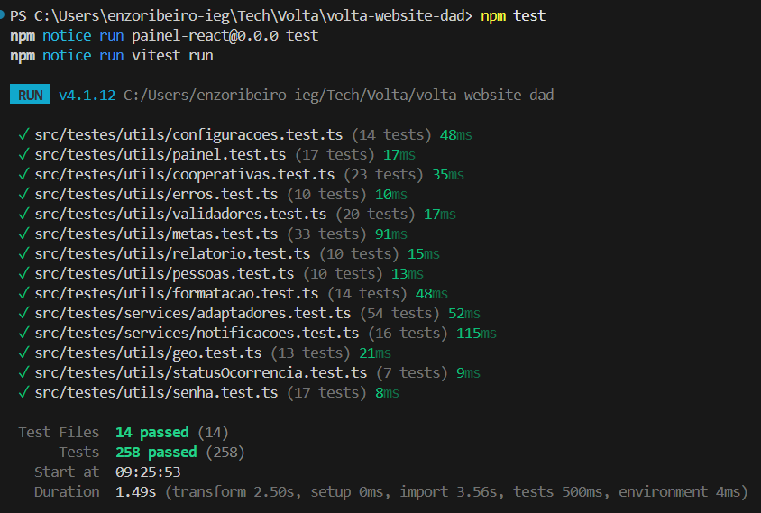

# VOLTA — Padrões de Teste

## 1. Objetivo

Este documento resume como os testes são feitos em cada repositório do VOLTA: ferramentas, tipos de teste, organização e execução no CI. Também aponta o que ainda falta cobrir.

## 2. Visão geral

| Repositório | Ferramentas | Tipos de teste | Quantidade aproximada |
|---|---|---|---|
| `volta-api-core` | JUnit 5, Mockito, AssertJ, Spring MockMvc | Unitário, validação de DTO, segurança | 253 testes |
| `volta-api-redis` | JUnit 5, AssertJ, Spring Boot Test, Redis real | Unitário, integração HTTP, integração com Redis | 148 testes |
| `volta-chatbot` | pytest, httpx, classes fake | Unitário, API (rotas), contrato dos agentes | 132 testes |
| `volta-mobile` | JUnit 4 | Unitário e contrato JSON | 83 testes |
| `volta-website-dad` | Vitest | Unitário (funções e regras do painel) | 210 casos em 14 arquivos |

## 3. Princípios comuns

- **Testar regra de negócio, validação e segurança**, que são os pontos de maior risco.
- **Isolar o que está sendo testado:** dependências externas (banco, outras APIs, IA) são trocadas por mocks ou fakes.
- **Testes independentes e repetíveis:** cada teste monta seus próprios dados e não depende da ordem de execução.
- **Nomes que explicam o comportamento**, como `givesFullScoreToATopRatedCooperativeRightAtTheOrigin` ou `test_blocks_prompt_injection`.
- **Contratos entre sistemas são testados**, para detectar quebras entre app, painel e APIs.
- **Os testes rodam automaticamente** em todo pull request, pelo GitHub Actions.

## 4. `volta-api-core` — API principal

- O JaCoCo mede a cobertura em cada `mvn verify` e **reprova o build abaixo de 35%** das linhas.
- Ficam fora da medição: DTOs, entidades, configurações e a classe principal.
- O CI sobe um PostgreSQL 16 de teste, roda `mvn --batch-mode verify` e publica o relatório de cobertura como artefato.

## 5. `volta-api-redis` — Ranking e cooperativas

- O JaCoCo **reprova o build abaixo de 85%** das linhas, o critério mais rigoroso do projeto.
- O CI sobe um Redis 7 e roda `mvn --batch-mode verify`.

## 6. `volta-chatbot` — Chatbot com IA

O CI instala as dependências com verificação de hash, roda o `ruff` (análise estática), confere se a aplicação importa sem erro e executa `python -m pytest`, publicando o relatório em XML. Ainda não há cobertura mínima definida, e os testes não chamam modelos de IA reais.

## 7. `volta-mobile` — Aplicativo Android


Os testes unitários ficam em `app/src/test/java/com/aula/volta/`, na mesma estrutura do código:

O CI usa Java 17, compila o APK de debug, roda `./gradlew testDebugUnitTest` e `lintDebug`, e publica o APK e os relatórios.

## 8. `volta-website-dad` — Painel web

Os números são contagem do código: cerca de 210 casos de teste em 14 arquivos.

- O CI executa `npm test` (`vitest run`) depois do lint e da verificação de tipos, e antes do build.
- Outras proteções: lint (`oxlint`), tipos (TypeScript), build de produção, hooks do Husky, commitlint e os mocks locais (`*.mock.ts`) para uso do painel sem backend.

## 9. Resumo dos padrões entre os repositórios

| Tema | API Core | API Redis | Chatbot | Mobile | Web |
|---|---|---|---|---|---|
| Testes unitários | Sim | Sim | Sim | Sim | Sim |
| Mocks ou fakes | Mockito | Servidor falso e Redis real | Classes fake | Nenhum | `vi.mock` e fábricas de dados |
| Teste de integração | Parcial (`@WebMvcTest`) | Sim (HTTP e Redis) | Parcial (rotas) | Não | Não |
| Teste de segurança | Sim | Sim | Sim | Validação de senha | Validação de senha |
| Teste de contrato | Não | Sim | Sim | Sim | Não |
| Cobertura medida | JaCoCo (mín. 35%) | JaCoCo (mín. 85%) | Não | Não | Não |
| Roda no CI | Sim | Sim | Sim | Sim | Sim |

## 10. Evidências de execução

Os prints ficam em [`docs/prints/`](prints/).

### 10.1. `volta-api-core`

Pipeline de CI (`build-test`) aprovado:


Relatório de cobertura (JaCoCo):


### 10.2. `volta-api-redis`

Pipeline de CI (`build-test`) aprovado:


Relatório de cobertura (JaCoCo):


### 10.3. `volta-chatbot`

Pipeline de CI (`validate-test`) aprovado:


Execução local do `python -m pytest -q`:


### 10.4. `volta-mobile`

Pipeline de CI (`build-test`) aprovado, incluindo os testes unitários:


### 10.5. `volta-website-dad`

Pipeline de CI (`build-test`) aprovado:


Execução local do `npm test`:



## 11. Como executar

```bash
# volta-api-core (Java 21; precisa de PostgreSQL local e das variáveis do .env.example)
mvn verify

# volta-api-redis (Java 21; precisa de um Redis local na porta 6379)
./mvnw verify

# volta-chatbot
pip install -r requirements.txt -r requirements-dev.txt
python -m pytest -q

# volta-mobile
./gradlew testDebugUnitTest

# volta-website-dad (Node 20)
npm ci
npm test
```

## 12. Conclusão

As duas APIs Java têm a base de testes mais madura, com cobertura medida e mínima exigida no CI. Na API Redis, o mínimo de 85% e o uso de um Redis real dão boa confiança. O chatbot tem boa cobertura das regras de segurança e do fluxo de agentes. O app Android testa só a lógica pura. O painel web agora tem testes unitários (Vitest) para as regras do painel e já os executa no CI.